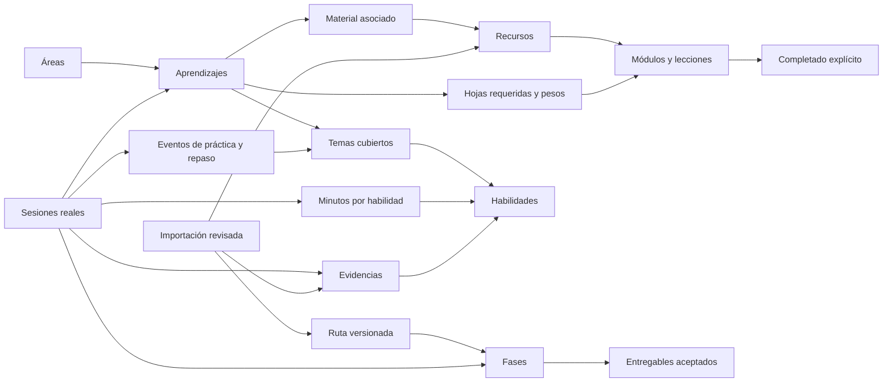

# Modelo de datos implementado

La fuente ejecutable es `supabase/migrations/001_learning_atlas.sql`, generada por `scripts/build_schema.py`. Hay **30 tablas de aplicación y una de recibos de operaciones**. Todas las entidades tienen UUID, `user_id`, fecha de creación y una clave única compuesta `(user_id, id)`; las relaciones usan esa clave para impedir enlaces entre cuentas.

## División de información

| Grupo | Tablas | Campos / responsabilidad principal |
|---|---|---|
| Usuario y áreas | `profiles`, `areas` | Nombre del espacio, zona horaria, minutos semanales, umbral de racha, revisión; nombres de áreas. |
| Aprendizajes | `learning_tracks` | Título, tipo, nombre oficial, plataforma, emisor, código, URL, meta, estimación global, estado, favorito, prioridad, notas, origen. |
| Material de estudio | `resources`, `track_resources` | Referencias y documentos vinculados a aprendizajes; un recurso puede servir a varios. |
| Temario y progreso | `units`, `track_units`, `unit_progress` | Jerarquía padre/hijo, orden y estimaciones; peso y obligatoriedad por aprendizaje; fecha de completado independiente. |
| Temas | `topics`, `resource_topics`, `track_topics` | Área, descripción y preferencia de repaso; contenido cubierto por recurso o aprendizaje. |
| Habilidades | `skills`, `topic_skills`, `track_skills` | Nombre, definición operativa, área; relación de cobertura con temas y aprendizajes. |
| Rutas | `learning_goals`, `goal_phases`, `phase_tracks` | Objetivo, fechas, disponibilidad, versión anterior; fases con presupuesto y margen; asociación disponible con aprendizajes. |
| Tiempo y práctica | `study_sessions`, `session_skills`, `topic_events` | Fecha local, zona, minutos reales, actividad, área, aprendizaje/fase opcionales; reparto de minutos; eventos aprendido/estudio/repaso/trabajo. |
| Evidencia | `learning_evidence`, `evidence_skills` | Entregable, descripción, enlace, fecha o período, sesión/aprendizaje opcionales; validación declarada y habilidades relacionadas. |
| Autoevaluaciones | `skill_rubrics`, `skill_assessments` | Rúbrica versionada; habilidad, fecha, nivel 0–3, contexto, enlace y método. |
| Aceptación de ruta | `milestones` | Entregable de fase, criterios, fecha de aceptación, evidencia opcional y notas. |
| Credenciales | `credentials` | Nombre oficial, emisor, tipo, fecha/período, caducidad, URL de verificación, notas; siempre declaradas por el usuario. |
| Importación y archivos | `import_jobs`, `attachments` | Archivo y hash, propuesta y hash, estado, resultado, extractor/modelo/prompt; referencia privada a recurso, credencial o evidencia. |
| Día libre | `daily_plans`, `plan_blocks` | Fecha, presupuesto, energía, generador; bloques ordenados, motivo y sesión realizada opcional. |
| Control de escritura | `mutation_receipts` | Usuario + ID de solicitud, intención y resultado confirmado. No contiene credenciales. |

`phase_tracks` y el destino de adjunto de credencial quedan disponibles en el esquema; la interfaz inicial vincula las sesiones directamente a fases y los documentos a recursos/evidencias. No se presentan como flujos de edición que ya estén disponibles.

## Escrituras y seguridad

La app usa la clave pública del proyecto y el JWT de la sesión autenticada. No utiliza `service_role`. No hay un cliente autenticado global compartido mediante `st.cache_resource`.

- `atlas_bootstrap()` crea el perfil del usuario autenticado si aún no existe.
- `atlas_snapshot()` devuelve sólo sus filas, protegido además por RLS.
- `atlas_apply()` ejecuta un lote dentro de la transacción del RPC. Bloquea el perfil, comprueba versión e idempotencia, fuerza el propietario desde `auth.uid()`, limita tablas/columnas/operaciones y comprueba claves y restricciones antes de confirmar.
- Las tablas conceden lectura a `authenticated`; las escrituras se realizan por el RPC. El rol `anon` no puede leer los registros ni invocar esos RPC.
- La función de escritura es `SECURITY DEFINER` con `search_path` vacío, nombres de tabla permitidos y columnas validadas. Los valores usan parámetros JSON, no concatenación de valores de usuario en SQL.
- Triggers diferidos validan límites de reparto de minutos, jerarquías sin ciclos, hojas contables y fases sin solapamiento. Las fechas de actividad no pueden ser futuras.
- Storage conserva los archivos en el bucket **privado** `learning-documents`, bajo `user_id/imports/...`. Sus políticas separan carpetas por usuario y evitan borrar adjuntos todavía referenciados.

Los IDs de cuenta y relaciones también se validan en el servicio Python, pero el aislamiento entre usuarios no depende de ocultar botones en la interfaz. [RLS en Supabase](https://supabase.com/docs/guides/database/postgres/row-level-security) y [seguridad de Storage](https://supabase.com/docs/guides/storage/security/access-control).

## Corrección e historial

Archivar retira un aprendizaje de la actividad principal conservando su información. Las sesiones se anulan con motivo; la anulación excluye sus minutos, práctica y evidencia de métricas y libera su bloque del plan para volver a registrarlo. Desmarcar una unidad elimina su completado y reactiva un aprendizaje que dependía de ella. Las rutas se replanifican mediante una versión nueva.

Los campos de revisión y recibos permiten recuperar un resultado confirmado aunque la interfaz no recibiera la respuesta. Después de una desconexión completa, revisa tu historial antes de volver a introducir una actividad nueva. La exportación JSON permite conservar los registros; una restauración general todavía no forma parte de la interfaz.

Este diseño realiza lecturas de snapshot completo por usuario. Es adecuado para el tracker personal previsto; si crece a un volumen alto, el siguiente cambio sería paginar consultas y agregar métricas en SQL, conservando estos contratos.
